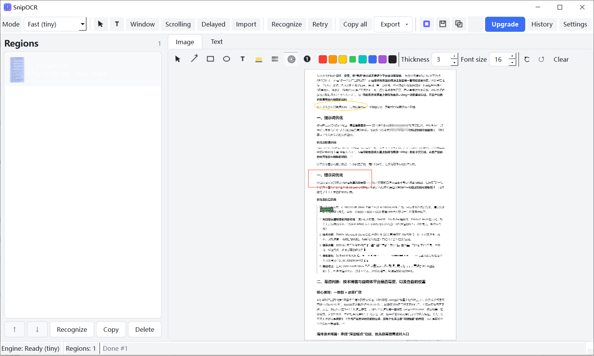
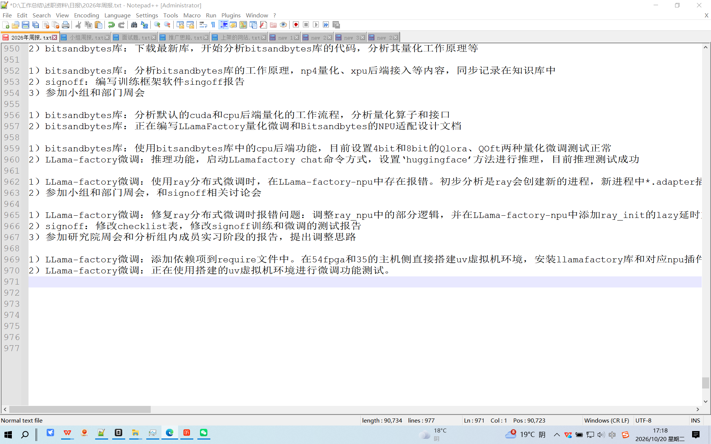
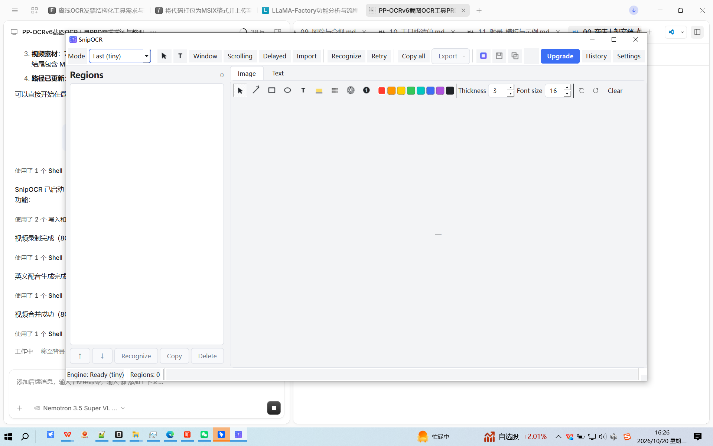

# CaptureOCR

**Screenshot OCR for Windows that ends in a table, not a folder of PNGs.**

Capture multiple regions in one pass, annotate them, and export a numbered Markdown table or CSV. PP-OCRv6 runs locally — Chinese, English, and mixed layouts. No account. No upload. $2.99 once.

[Website](https://lijiannan1241.github.io/CaptureOCR/) · [Microsoft Store](https://apps.microsoft.com/store/detail/9PBP8VBG4RJ1?cid=DevShareMCLPCS) · [FAQ](https://lijiannan1241.github.io/CaptureOCR/#frequently-asked-questions) · [Issues](https://github.com/lijiannan1241/CaptureOCR/issues)

## What it does

- **Multi-region capture.** Select 10+ regions in one session; they are numbered automatically. Reorder, delete, or undo before recognition.
- **Structured export.** Markdown table or CSV with region index, coordinates, confidence, and text — ready for Excel, a ticket, or a research note.
- **Annotate → beautify → OCR.** Arrows, boxes, highlights, mosaic, gradient backgrounds, shadows, and rounded corners in one window. The beautified image still yields extractable text.
- **Offline by default.** The tiny PP-OCRv6 model is bundled (~6.6 MB). The accurate model (~30 MB) downloads once and then runs offline.
- **Chinese, English, and mixed CJK.** PP-OCRv6 handles layouts where the built-in Windows OCR struggles, including vertical text and small print.
- **One-time purchase.** $2.99 on the Microsoft Store. No subscription, no account, no per-page OCR fee.

## Demo Video

<video controls width="820" poster="assets/shots/01-hero.png" preload="metadata">
  <source src="assets/videos/capture_01_1080p.mp4" type="video/mp4">
  Your browser does not support the video tag.
</video>

*CaptureOCR in action: multi-region capture, OCR, and Markdown/CSV export.*

## Install

1. Open the [Microsoft Store listing](https://apps.microsoft.com/store/detail/9PBP8VBG4RJ1?cid=DevShareMCLPCS).
2. Install on Windows 10/11 x64 (126 MB).
3. Launch CaptureOCR and press `Ctrl+Shift+X` (default capture hotkey), or use the tray menu.

## Screenshots

*Regions are numbered automatically. Reorder or delete before you export.*

*Markdown or CSV. Every row carries its region index, coordinates, confidence, and text.*

## FAQ

**Does it work offline?**
Yes. The tiny model is bundled and works offline immediately. The accurate model downloads once (~30 MB) and then also runs offline. No cloud OCR API is involved.

**Which languages are supported?**
The small tier covers 50 languages, including Chinese, Japanese, English, and 46 Latin-script languages. The tiny tier covers 49 and excludes Japanese — use Accurate mode for Japanese.

**Does it support scrolling screenshots?**
Yes, as a best-effort feature in v1.0. It works best in apps with stable scrolling; virtualized or lazy-loading lists can fail. Use region capture as the fallback.

[Read the full FAQ](https://lijiannan1241.github.io/CaptureOCR/#frequently-asked-questions) · [Compare with other tools](https://lijiannan1241.github.io/CaptureOCR/#how-it-compares)

## Privacy

Screenshots and recognized text stay on your device. CaptureOCR does not upload image or OCR content. Settings and session files are stored locally. The only network access is the optional accurate-model download and Microsoft Store licensing.

## Under the hood

- OCR: PP-OCRv6 (tiny / small) via ONNX Runtime
- UI: PySide6 (Qt for Python)
- Capture: `mss` + `pywin32`
- Distribution: MSIX / Microsoft Store (`runFullTrust`)

## Project

This repository hosts the product page and the issue tracker. The application itself is distributed through the Microsoft Store.

## License

The application and bundled models are distributed under their respective licenses. PP-OCRv6 models are Apache-2.0. See the Microsoft Store listing for the end-user license terms.